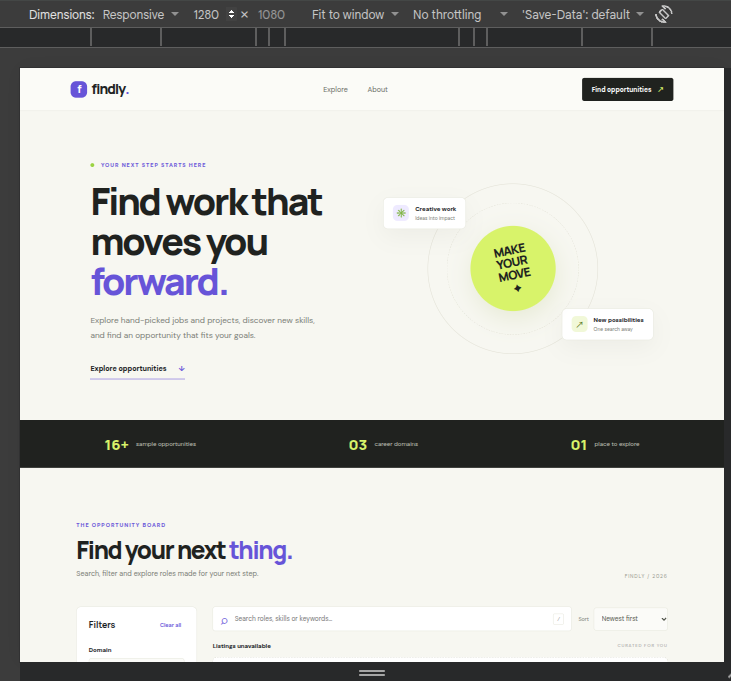
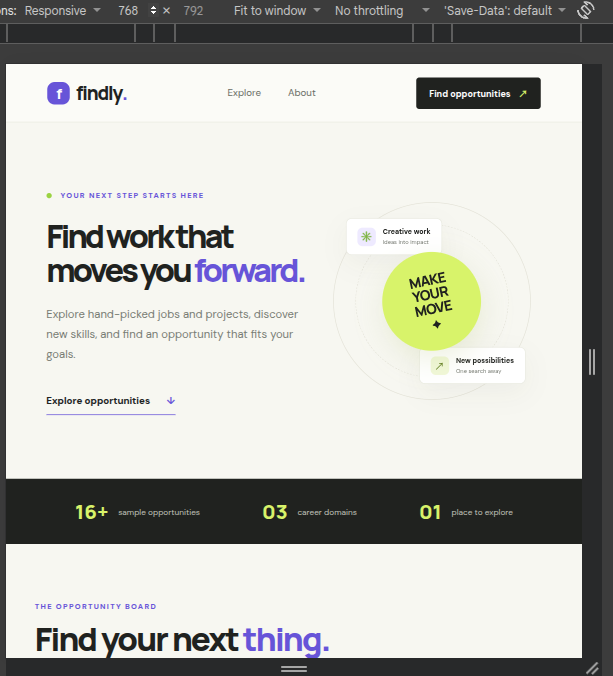

# Findly — Searchable Job & Project Listing Dashboard

Findly is a responsive front-end dashboard concept for exploring sample job and project opportunities. It is built with HTML, CSS and vanilla JavaScript, and loads its cards from a local JSON dataset.

> **Note:** All listings are fictional sample data created for this learning project. They are not live vacancies or endorsements from the named sample organizations.

## Features
- Live search across listing titles, company names, domains, skills, keywords, descriptions and work modes.
- Domain, experience-level and work-mode filters.
- Search and all selected filters are combined using logical **AND**.
- Sort by newest first or title A–Z.
- Six listings per page with previous/next pagination.
- Loading, empty-results and data-loading error states, including retry.
- Responsive layout for desktop, tablet and mobile, keyboard-friendly search shortcut (`/`), visible focus styles and reduced-motion support.

## Tech stack
- HTML5 semantic elements
- CSS3 (Grid, Flexbox, custom properties and responsive media queries)
- Vanilla JavaScript (ES6+, Fetch API, array methods and DOM events)
- Local JSON dataset (`data/listings.json`)

## Project structure
```text
CodeNova-Task-4-Findly-Job-Project-Dashboard/
├── index.html
├── style.css
├── script.js
├── README.md
└── data/
    └── listings.json
```

## Run locally
Because the app uses `fetch()` to load JSON, open it through a local web server rather than directly as a `file://` page.

1. Download or clone this repository.
2. Open the folder in a code editor with a local preview/server extension, or use any simple local static server.
3. Open the local server URL shown by the tool (for example, `http://localhost:5500`).

## Search and filtering logic
The app first converts the search term to lowercase and checks it against a combined searchable string containing the title, company, domain, experience level, work mode, location, description, skills and keywords. Each category filter is then checked separately. A listing is included only when `matchesSearch && matchesDomain && matchesLevel && matchesMode` is true. This is logical AND behavior, so every active condition must match.

## Debouncing
The search input uses a 250 ms debounce. Each keystroke clears the previous timeout and schedules filtering after the user pauses typing. This avoids running the filtering operation unnecessarily for every rapid keystroke while keeping the experience responsive.

## Sorting and pagination
Newest-first sorting compares the ISO date strings as dates. Alphabetical sorting uses `localeCompare()` on listing titles. After filtering and sorting, the results are divided into pages of six items using `slice()`. The page is reset when a filter or sort option changes, and navigation buttons are disabled at the first and last pages.

## UI states
- **Loading:** shown while the JSON dataset is being fetched.
- **Results:** matching listing cards and pagination are displayed.
- **Empty:** shown when no listing matches the search and selected filters; the user can reset the search.
- **Error:** shown if the JSON file cannot be loaded or is invalid; the retry button attempts to load it again.

## Deploy with GitHub Pages
1. Push all files and the `data` folder to the root of a public GitHub repository.
2. Open the repository's **Settings → Pages**.
3. Under **Build and deployment**, choose **Deploy from a branch**.
4. Select branch `main` and folder `/ (root)`, then save.
5. Wait for GitHub Pages to publish the site. Open the URL shown in the Pages settings and test the search, filters and pagination.

## Screenshots

### Desktop View


### Tablet View


### Mobile View

